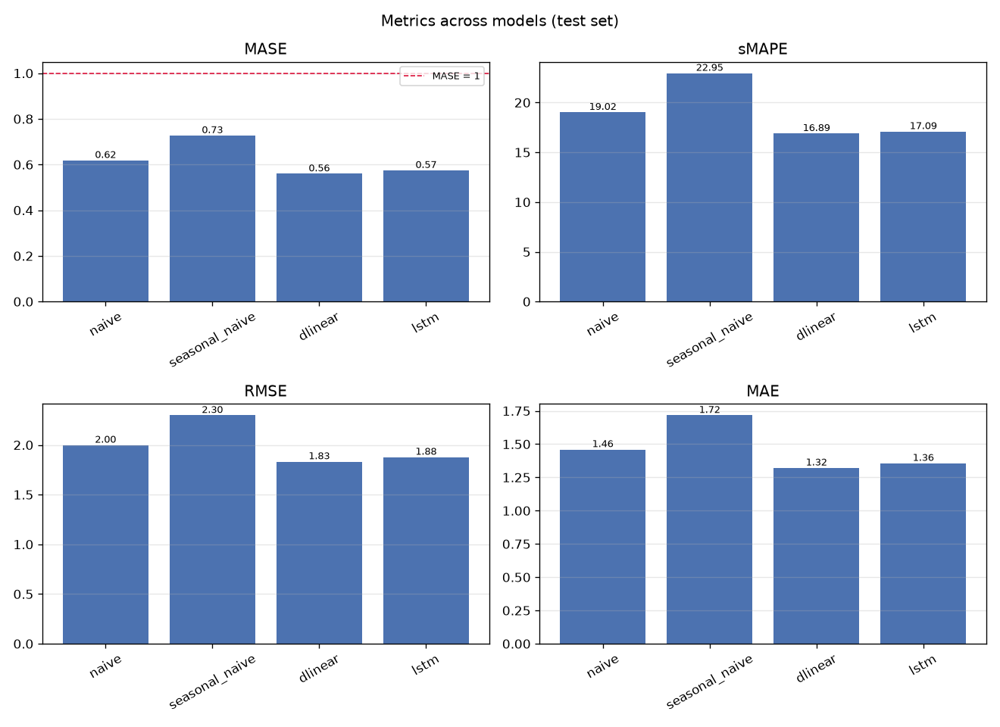
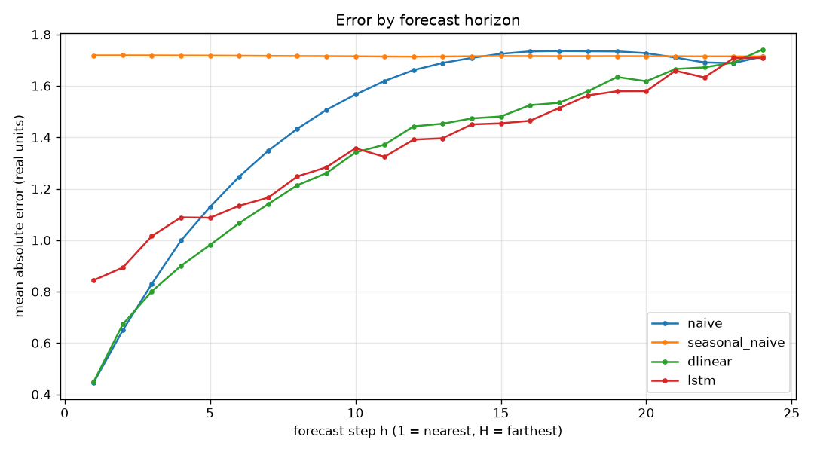
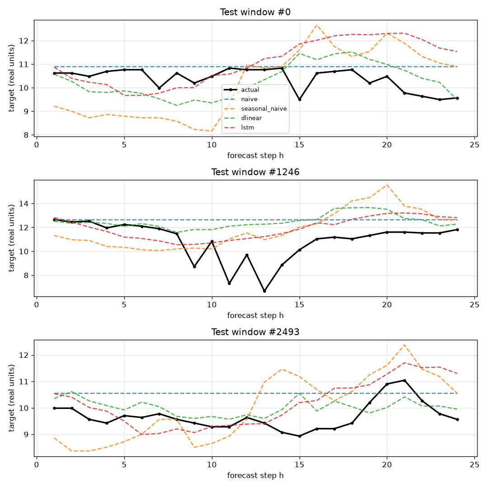

# Multi-Horizon Time-Series Forecasting Benchmark

A small, reproducible benchmark that forecasts a real multivariate time series
**24 hours ahead** and honestly compares four models under **leakage-free**
evaluation, measured against a naive baseline. The point isn't a leaderboard win —
it's *correct evaluation*: identical splits, identical windows, one scoring path,
and a headline metric (MASE) that says plainly whether a model earned its
complexity.

**Dataset:** ETTh1 — Electricity Transformer Temperature, hourly (17,420 rows,
2016‑07‑01 → 2018‑06‑26). Target `OT` (oil temperature); the six transformer‑load
columns are covariates. Downloaded programmatically from
[`zhouhaoyi/ETDataset`](https://github.com/zhouhaoyi/ETDataset); a Jena‑Climate
fallback is built in.

---

## Results (test set, ranked by MASE)

| model          |   MASE |   sMAPE |   RMSE |    MAE |
|:---------------|-------:|--------:|-------:|-------:|
| **dlinear**    | **0.5597** | 16.8922 | 1.8325 | 1.3213 |
| lstm           | 0.5744 | 17.0887 | 1.8776 | 1.3560 |
| naive          | 0.6183 | 19.0211 | 1.9985 | 1.4597 |
| seasonal_naive | 0.7270 | 22.9463 | 2.2977 | 1.7162 |

*(regenerated by `python main.py`; see `reports/results.md`)*

**MASE < 1 means a model beats an in‑sample seasonal‑naive one‑step forecast.**
All four clear that bar here — `OT` is a smooth, slowly‑varying series, so even
persistence is respectable.



---

## Honest takeaway (this is the point)

**The linear model won, and the LSTM did not earn its complexity.** DLinear
(a couple of `Linear(96→24)` layers on a trend/remainder decomposition) posts the
best MASE, sMAPE, RMSE and MAE. The two‑layer LSTM lands **second — barely ahead of
naive persistence** and behind DLinear on every metric, despite ~100× more
parameters, a training loop, dropout, and early stopping.

This mirrors the finding of Zeng et al. (2022), *Are Transformers Effective for
Time Series Forecasting?* — on datasets like ETT, a well‑posed linear model is a
brutally strong baseline. The error‑by‑horizon plot adds nuance: the LSTM is
actually **worse than persistence at short horizons** (h = 1–3) and only pulls
even further out, while DLinear tracks the best-of-both curve across all horizons.
Seasonal‑naive is flat across the horizon (it copies "same hour yesterday", so its
error doesn't depend on how far ahead you look) and is the weakest model here.



If this were a portfolio piece claiming "I built an LSTM forecaster," that would be
the wrong story. The right story is: *I built a benchmark, discovered a linear
model beat the LSTM, and can show exactly why.*



---

## Method

**Task.** Given the last `L = 96` hourly observations of all channels, predict the
next `H = 24` steps of the target in one shot (**direct multi‑horizon**, not
autoregressive — this avoids compounding error and keeps the LSTM‑vs‑DLinear
comparison fair).

**Leakage‑free pipeline (the part that matters).**
1. **Chronological split** 70 / 15 / 15 — earliest rows train, latest test. Never
   shuffled across time.
2. **Scaler fit on train only**, then applied to val/test. This is the single most
   common way CV forecasting projects leak, so it's enforced in one place
   (`src/data.py`) and pinned by a test (`tests/test_no_leakage.py`).
3. **Windows built per split**, so no sliding window ever straddles a split
   boundary. The test asserts this by exact window‑count accounting.

**Metrics** (all from scratch, in `src/metrics.py`, on inverse‑scaled real units):
- **MASE** (headline) = test MAE ÷ *in‑sample seasonal‑naive MAE on train*. Scale‑
  free and defined relative to naive, so one number answers "did it beat naive?"
- **sMAPE**, **RMSE**, **MAE** for readers who expect them.

**Models** (identical windows, identical scoring):
| model | idea |
|---|---|
| naive | persistence: `ŷ(t+h) = y(t)` — the bar to beat |
| seasonal_naive | `ŷ(t+h) = y(t+h−24)` — "same hour yesterday" |
| dlinear | trend/remainder decomposition + one `Linear(L→H)` each (Zeng et al. 2022) |
| lstm | 2‑layer LSTM encoder → `Linear(hidden→H)` direct multi‑horizon head |

A `src/models/foundation.py` **stub** documents the same interface for a later
zero‑shot comparator (e.g. Amazon Chronos) — dropping it in requires no pipeline
changes.

**Known structure the models could exploit further:** the series has a strong
daily cycle (`m = 24`) *and* a weekly one (`168 h`). We only encode the daily
season (in seasonal‑naive and the MASE scale); a weekly‑aware baseline is an
obvious next step.

---

## How to run

```bash
# 1. Environment (Python 3.11+; tested on 3.12)
python -m venv .venv && source .venv/bin/activate
pip install -r requirements.txt --extra-index-url https://download.pytorch.org/whl/cpu

# 2. Run the whole benchmark: downloads data, trains, evaluates, writes reports/
python main.py

# 3. Tests — includes the leakage guardrails
pytest -q
```

`python main.py` is fully self‑contained: it downloads + caches ETTh1 to
`data/raw/` on first run (git‑ignored), trains the neural models with fixed seeds,
and regenerates every artifact in `reports/` (table, CSV, three plots, and each
model's test predictions). Runtime is ~3 min on CPU.

Everything tunable lives in `config.yaml` (window sizes, split ratios, seed,
hyperparameters) — there are no magic numbers in the code.

---

## Repo layout

```
src/
  data.py            # download, cache, chronological split, leakage-safe scaling
  windowing.py       # sliding (L→H) window builder + torch Dataset
  metrics.py         # MASE / sMAPE / RMSE / MAE, from scratch
  train.py           # training loop, early stopping + checkpoint on val MASE
  evaluate.py        # uniform prediction, metrics table, plots
  models/
    naive.py  seasonal_naive.py  dlinear.py  lstm.py  foundation.py(stub)
main.py              # CLI: run every model end-to-end, emit reports/
config.yaml          # all hyperparameters / splits / seeds
tests/               # test_no_leakage.py, test_metrics.py
reports/             # committed: results table + plots + predictions
SPEC.md              # full technical spec / architecture
```

---

## Reproducibility & honesty notes

- Fixed seeds for `random`, `numpy`, `torch` + deterministic cuDNN.
- Scaler statistics depend on **train only** — proven by a test, not a comment.
- Early stopping and model selection are on **validation MASE**, not raw loss, so
  selection optimizes the metric we report.
- Results above were produced by the committed code and config on this dataset;
  `python main.py` reproduces them.

## Citation

Zhou et al., *Informer: Beyond Efficient Transformer for Long Sequence Time‑Series
Forecasting*, AAAI 2021. [arXiv:2012.07436](https://arxiv.org/abs/2012.07436) —
source of the ETT datasets.

Zeng et al., *Are Transformers Effective for Time Series Forecasting?*, 2022.
[arXiv:2205.13504](https://arxiv.org/abs/2205.13504) — DLinear.
