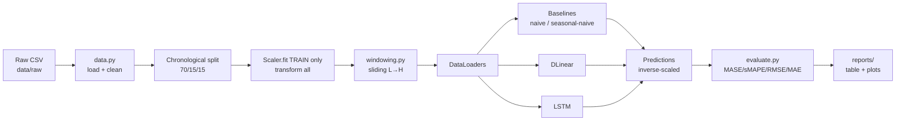

# Time-Series Forecasting Benchmark — Technical Spec & Architecture

**Version:** 1.0
**One-liner:** A reproducible pipeline that benchmarks classical baselines, a linear model, and an LSTM on a **multi-horizon** forecasting task, with **leakage-free** evaluation measured against a naive baseline.

---

## 1. Objectives & Non-Goals

**Objectives**
- Forecast `H` future steps of a real multivariate time series.
- Compare models **fairly** on identical splits, windows, and metrics.
- Prove the neural model earns its complexity by beating a naive persistence baseline (or honestly report that it doesn't).
- Be runnable end-to-end with one command and fully reproducible.

**Non-goals (explicitly out of scope — say this in interviews)**
- Real-time / streaming inference.
- Hyperparameter search beyond a small manual sweep.
- Beating published SOTA. The value is *correct evaluation*, not leaderboard rank.
- Deployment / serving.

---

## 2. Dataset Specification

| Field | Value |
|---|---|
| Primary source | ETTh1 — Electricity Transformer Temperature (hourly), from `zhouhaoyi/ETDataset` on GitHub |
| Fallback source | Jena Climate (Keras-hosted) if primary is unreachable |
| Frequency | Hourly (`m = 24` seasonal period) |
| Target variable | `OT` (oil temperature); Jena fallback: `T (degC)` |
| Covariates | Remaining numeric columns (multivariate input) |
| Storage | Raw CSV cached at `data/raw/`, **git-ignored** |

**Schema contract:** loader returns a `pandas.DataFrame` indexed by timestamp, sorted ascending, no gaps (assert monotonic index), no NaNs after forward-fill.

---

## 3. Task Formulation

Given a window of the last `L` observations, predict the next `H`:

```
Input : X ∈ ℝ^{L × C}   (L past steps, C channels)
Output: Y ∈ ℝ^{H}       (H future steps of the target)
```

- `L = 96` (input window), `H = 24` (forecast horizon), `m = 24` (season).
- **Direct multi-horizon**: models emit all `H` steps in one forward pass (no autoregressive feedback). This avoids compounding error and keeps the comparison against DLinear honest.
- Split **chronologically**: 70% train / 15% val / 15% test. **Never shuffle across time.**

**Leakage guardrail (non-negotiable):** the scaler is fit on **train only**, then applied to val/test. A unit test asserts that no val/test statistic touches the scaler fit. Windows never straddle a split boundary.

---

## 4. System Architecture



Design principle: **one data path, many models.** Every model consumes identical windows and is scored by identical code, so differences are attributable to the model, not the pipeline.

---

## 5. Component (Module) Specs

| Module | Responsibility | Key inputs → outputs |
|---|---|---|
| `src/data.py` | Download, cache, clean, chronological split, leakage-safe scaling | path → `(train_df, val_df, test_df, scaler)` |
| `src/windowing.py` | Build sliding `(L→H)` windows; wrap as `Dataset` | scaled df → `torch Dataset` yielding `(X[L,C], y[H])` |
| `src/metrics.py` | MASE, sMAPE, RMSE, MAE from scratch | `(y_true, y_pred, y_train)` → floats |
| `src/models/naive.py` | Persistence: `ŷ(t+h)=y(t)` | window → forecast |
| `src/models/seasonal_naive.py` | `ŷ(t+h)=y(t+h−m)` | window → forecast |
| `src/models/dlinear.py` | Decomposition + linear heads | `X[B,L,C]` → `ŷ[B,H]` |
| `src/models/lstm.py` | Stacked LSTM + linear multi-horizon head | `X[B,L,C]` → `ŷ[B,H]` |
| `src/train.py` | Training loop, early stopping on val MASE, checkpointing | model, loaders → best checkpoint |
| `src/evaluate.py` | Compute metrics, build table + plots | predictions → `reports/` |
| `main.py` | Orchestrate: run every model, emit report | `config.yaml` → full run |

**Interface contract for all neural models:** `forward(X: Tensor[B, L, C]) -> Tensor[B, H]`. Baselines expose the same signature (no training) so `evaluate.py` treats them uniformly. Keep a stub `foundation.py` with the same interface for a later zero-shot Chronos comparator.

---

## 6. Model Specs

**Naive (baseline).** No parameters. The bar everything must clear. A model that can't beat this is worthless — and knowing to check is the whole point.

**Seasonal-naive.** No parameters. `season = 24`. Strong on daily-cyclic data; often surprisingly hard to beat.

**DLinear** (Zeng et al., 2022 — *Are Transformers Effective for Time Series Forecasting?*).
- Decompose input into **trend** (moving-average kernel, e.g. size 25) and **remainder** (`series − trend`).
- One `Linear(L → H)` per component; sum the two outputs.
- Channel-independent (share/replicate across channels). Tiny, fast, strong.

**LSTM.**
- `nn.LSTM(input_size=C, hidden_size=64, num_layers=2, dropout=0.2, batch_first=True)`.
- Take the final hidden state → `Linear(hidden → H)` → direct multi-horizon output.
- Train with MSE loss, Adam, early stopping on **validation MASE** (not loss).

---

## 7. Evaluation Spec

All metrics computed on the **test set**, on **inverse-scaled** values (real units), reported **per model** and ranked in a markdown table.

**MASE** (Mean Absolute Scaled Error — Hyndman & Koehler). Scale factor is the in-sample one-step seasonal-naive error on the **training** set:

```
scale = mean( |y_train[t] − y_train[t−m]| )   for t = m..N_train
MASE  = mean( |y_true − y_pred| ) / scale
```
Interpretation: `MASE < 1` ⇒ beats the naive seasonal forecast. This is the headline number.

**sMAPE**
```
sMAPE = mean( 2·|y_true − y_pred| / (|y_true| + |y_pred|) ) × 100
```

**RMSE / MAE**: standard, for readers who expect them.

**Required plots → `reports/`**
1. Predicted vs actual for a few representative test windows.
2. **Error-by-horizon**: mean error at each step `h = 1..H` (does accuracy decay with distance? it should — showing this is a maturity signal).
3. Metric bar chart across models.

**Honest findings (README section):** state plainly which model won. If DLinear or seasonal-naive beats the LSTM (common), report it. Hiding it defeats the purpose; showing it is what makes you look like an engineer, not a hype-follower.

---

## 8. Config Schema (`config.yaml`)

```yaml
data:
  source: ett            # ett | jena
  target: OT
window:
  L: 96                  # input length
  H: 24                  # forecast horizon
  season: 24
split:
  train: 0.70
  val: 0.15
  test: 0.15
train:
  seed: 42
  epochs: 50
  batch_size: 64
  lr: 0.001
  patience: 8            # early stopping on val MASE
models: [naive, seasonal_naive, dlinear, lstm]
```

---

## 9. Repo Layout

```
.
├── src/
│   ├── data.py
│   ├── windowing.py
│   ├── metrics.py
│   ├── train.py
│   ├── evaluate.py
│   └── models/
│       ├── naive.py
│       ├── seasonal_naive.py
│       ├── dlinear.py
│       ├── lstm.py
│       └── foundation.py      # stub interface for later Chronos comparator
├── main.py
├── config.yaml
├── reports/                   # generated table + plots (committed)
├── data/raw/                  # git-ignored
├── tests/
│   └── test_no_leakage.py
├── requirements.txt
├── README.md
└── SPEC.md                    # this file
```

---

## 10. Reproducibility Requirements

- Fixed seeds for `random`, `numpy`, `torch` (and `torch.backends.cudnn.deterministic = True`).
- All hyperparameters live in `config.yaml`; no magic numbers in code.
- `python main.py` regenerates every artifact in `reports/` from scratch.
- `requirements.txt` pinned to exact versions.

---

## 11. Acceptance Criteria (Definition of Done)

- [ ] `python main.py` runs end-to-end with zero manual steps.
- [ ] `tests/test_no_leakage.py` passes: scaler statistics depend only on train data; no window crosses a split boundary.
- [ ] Naive baseline yields a sane `MASE ≈ 1.0` (sanity check for the metric).
- [ ] All four models produce a results table in `reports/` ranked by MASE.
- [ ] Error-by-horizon plot exists and shows the expected decay.
- [ ] README leads with the results table and a one-paragraph **honest** takeaway.
- [ ] Repo is clean: typed where sensible, small functions, no notebook required to reproduce.

---

## 12. Interview-Defense Notes (why each choice)

- **Direct multi-horizon over autoregressive:** avoids compounding error and makes the LSTM-vs-DLinear comparison apples-to-apples.
- **MASE as headline:** scale-free and defined *relative to naive*, so a single number answers "did the model earn its keep?"
- **DLinear included deliberately:** when asked "why not a transformer / why LSTM," the answer is "I benchmarked against a linear model — here's what actually won." Senior answer regardless of outcome.
- **Leakage test as code:** most CV projects leak through the scaler. A passing test proves you know the failure mode.
- **The story:** not "I built an LSTM," but "I built a forecasting benchmark, found that ___ beat the LSTM, and here's why." That survives scrutiny.
